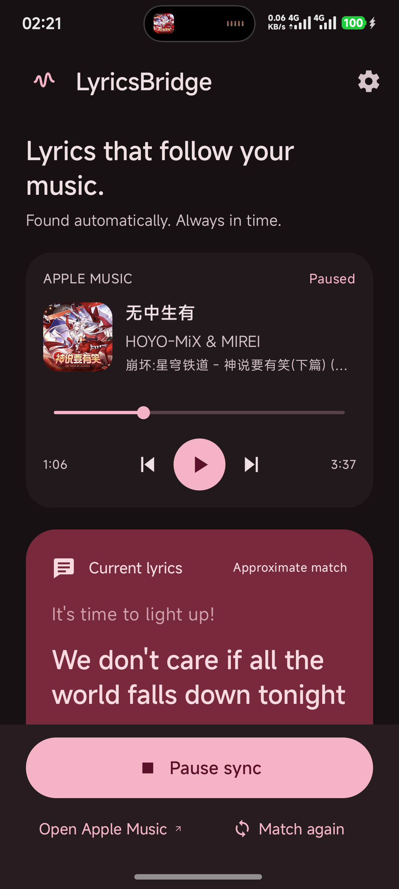
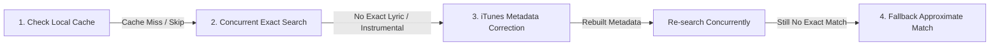
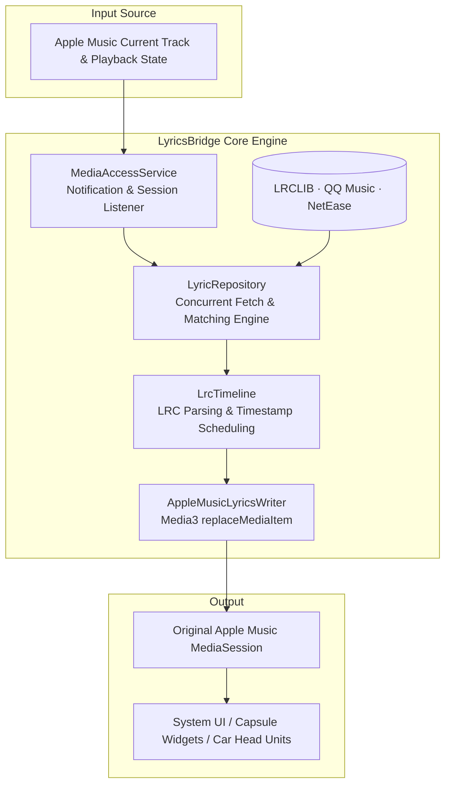

<p align="center">
  
</p>

<h1 align="center">LyricsBridge</h1>

<p align="center">
  <b>Lyrics that follow your music.</b><br>
  No Root, Shizuku, or app hooking required · Real-time lyric fetching & MediaSession metadata synchronization for Apple Music on Android
</p>

<p align="center">
  
  
  
  <a href="LICENSE"></a>
</p>

<p align="center">
  <a href="README.md">简体中文</a> · <b>English</b>
</p>

<p align="center">
  <a href="#app-preview">App Preview</a> •
  <a href="#features">Features</a> •
  <a href="#getting-started">Getting Started</a> •
  <a href="#lyric-matching">Lyric Matching</a> •
  <a href="#how-it-works">How It Works</a> •
  <a href="#compatibility-and-limitations">Compatibility & Limitations</a> •
  <a href="#build-from-source">Build from Source</a> •
  <a href="#testing">Testing</a> •
  <a href="#disclaimer">Disclaimer</a>
</p>

---

**LyricsBridge** is an Android utility designed to bring real-time synchronized LRC lyrics to Apple Music. By tracking Apple Music's playback state and track metadata, the app concurrently fetches accurate timed lyrics from **LRCLIB**, **QQ Music**, and **NetEase Cloud Music**, injecting dynamic LRC lines directly into Apple Music's original `MediaSession` metadata extension fields. This enables seamless lyric display on supported system interfaces (such as status bar capsules or island widgets) and Bluetooth head units. **No Root, Shizuku, or Apple Music hooking required.**

---

<a id="app-preview"></a>

## 📱 App Preview

<p align="center">
  
</p>

<p align="center"><sub>Dark appearance · English interface screenshot on actual device</sub></p>

---

## Contents

- [App Preview](#app-preview)
- [Features](#features)
- [Getting Started](#getting-started)
- [Lyric Matching](#lyric-matching)
- [How It Works](#how-it-works)
- [Compatibility and limitations](#compatibility-and-limitations)
- [Build from source](#build-from-source)
- [Testing](#testing)
- [Tech stack](#tech-stack)
- [Disclaimer](#disclaimer)
- [License](#license)

---

<a id="features"></a>

## ✨ Features

| Feature | Description |
| :--- | :--- |
| **Multi-Provider Search** | Concurrently queries LRCLIB, QQ Music, and NetEase Cloud Music, utilizing the first available exact lyric result while automatically canceling redundant pending requests. |
| **Catalog Metadata Correction** | When exact vocal lyrics are missing, looks up official iTunes catalog metadata via Apple Track ID to retry queries using canonical track title, artist, and album names. |
| **Smart Status Indicators** | Provides real-time search feedback. Approximate or guessed results feature clear UI badges and notice text at the beginning of the lyrics, localized to the app language. |
| **High-Precision Sync** | Real-time tracking of playback, pauses, seeking, and automatic track transitions, scheduled accurately around LRC timestamp boundaries. |
| **Super Island Lyrics Switch** | Optionally shows the current lyric as the system media title while retaining song titles inside Apple Music. Turning the switch off or stopping sync restores the title. |
| **Playback Controls** | Built-in play/pause, previous/next, and seek bar controls, paired with a 3-line scrollable lyric preview card with smooth transition animations. |
| **Local Cache** | Caches up to 100 matching results locally. Includes a **Match again** option to bypass cached data for the current song whenever needed. |
| **Modern UI & Localization** | Built with Material 3, supporting automatic system Light/Dark theme switching, alongside Chinese, English, and System Default language options. |

---

<a id="getting-started"></a>

## 🚀 Getting Started

### Prerequisites

- **OS**: Android 8.0 (API level 26) or newer.
- **App**: Apple Music for Android installed and able to play music.
- **Permissions**: Grant **Notification Access** to read current track info and access active media sessions.
- **Network**: Internet connection required for fetching new lyrics; cached results are reused locally offline.

### Enable Sync Steps

1. Build and install the APK following the [Build from Source](#build-from-source) section.
2. Open LyricsBridge and use **Permission setup** on the home screen to grant **Notification access**. You can also enable **Status notifications**. On Xiaomi, Redmi, and POCO devices, use the guide to open Settings and set LyricsBridge’s **Battery saver** to **No restrictions** to keep lyrics updating in the background.
3. Open Apple Music and start playing any track.
4. Return to LyricsBridge to view lyrics and matching status. Auto-sync is enabled by default.
5. If synchronization was manually paused, tap **Start auto-sync** to resume. Tap **Match again** if lyrics appear incorrect.
6. To show lyrics on Xiaomi Super Island, enable **Super Island lyrics** in Settings. The switch is off by default and its value is saved on this device.

> [!NOTE]
> **Manual Pause Persistence**: Manual pause states are persisted. When auto-sync is enabled, launching the app, reconnecting the notification listener service, or detecting Apple Music notification/session changes will automatically trigger synchronization.

---

<a id="lyric-matching"></a>

## 🎯 Lyric Matching

### Pipeline Overview



1. **Check Local Cache**: Validates and reuses local matching records for the current track.
2. **Concurrent Exact Search**: Submits an initial request to LRCLIB while concurrently querying QQ Music and NetEase. Employs the first valid exact lyric result and cancels remaining requests.
3. **Resolve Catalog Metadata**: If no exact vocal lyrics are returned, or if only instrumental results are found, queries the Chinese (CN) and US (US) iTunes Search/Lookup APIs using the numeric Apple Track ID. Retries search if catalog title or artist differs.
4. **Try Approximate Match**: If exact matches remain unavailable, ranks eligible candidates by title similarity; retains explicit instrumental results over approximate matches.

### Matching Rules & Criteria

| Match Type | Conditions & Evaluation Rules |
| :--- | :--- |
| **Exact** | Normalized titles match and at least one artist matches. When both durations are known, the difference must be within 1 second. Same album matches take precedence, followed by duration proximity. |
| **Approximate** | Both durations are known and within 1 second, with at least one matching artist. Ranked by title similarity and duration closeness. |
| **Instrumental** | Retains explicit instrumental markers from providers while waiting to see if other sources return exact vocal lyrics. NetEase's "no lyrics" flag alone is not treated as definitive instrumental proof. |

- **Lyric Data Providers**: [LRCLIB](https://lrclib.net/) · QQ Music · NetEase Cloud Music
- **Catalog Metadata API**: [Apple iTunes Search / Lookup API](https://performance-partners.apple.com/search-api)

---

<a id="how-it-works"></a>

## 🛠️ How It Works



<details>
<summary><b>🔍 Media Session Details & Extension Fields (Click to expand)</b></summary>

<br>

`MediaAccessService` discovers Apple Music's active media sessions via Notification Access; `BridgeService` tracks current track metadata and state; `LrcTimeline` parses LRC timestamps; `AppleMusicLyricsWriter` safely updates the original session's `MediaMetadata` lyric fields using Media3's `replaceMediaItem` API.

| Extension Field Key | Data Type | Description |
| :--- | :--- | :--- |
| `ucar.media.metadata.LYRICS_WHOLE` | `String` | Full LRC lyrics text with timestamps, or matching status message |
| `ucar.media.metadata.LYRICS_LINE` | `String` | Current single-line lyric text corresponding to current playback position |
| `ucar.media.metadata.LYRICS_STATUS` | `Long` | Lyric availability status: `0` for available/synced; `1` for no lyrics or instrumental |

Synchronization preserves the original Media3 track title, artist, and queue identifier. With **Super Island lyrics** enabled, the current lyric is written to `android.media.metadata.TITLE` in Media3 metadata extras, which Apple Music publishes as the system media title. Apple Music keeps its original song title, and LyricsBridge uses the original Media3 information to identify tracks. Disabling the switch, stopping sync, or having no available lyric restores the song title. Background updates use media callbacks and lyric boundary scheduling, maintained by a low-priority Foreground Service notification.

</details>

---

<a id="compatibility-and-limitations"></a>

## ⚠️ Compatibility & Limitations

- **Display Receiver Support**: Default synchronization requires receivers to read the lyric extension fields. With **Super Island lyrics** enabled, Xiaomi Super Island displays lyrics through the system media title. System notifications and Bluetooth head units reading that title also receive lyrics. Actual behavior depends on device firmware and receiver implementation.
- **Apple Music Client Versions**: Metadata writing relies on Apple Music's Media3 behavior, which may change in future app updates. Tested on Xiaomi 15 (HyperOS 4) for automatic track changes and timed line updates while both apps were in the background on the home screen.
- **Third-Party API Stability**: QQ Music and NetEase endpoints are undocumented and subject to change or temporary outage. Inaccurate provider metadata (durations, versions, artist credits) can affect matching.
- **Multilingual Metadata & Native Lyrics**: iTunes Lookup only corrects metadata available in its regional catalogs. Automatic cross-region track ID mapping, complete multilingual title mapping, and direct retrieval of Apple Music's own lyrics are not supported.
- **Background Recovery Constraints**: System power-saving and background-autostart restrictions may disrupt sync. `START_STICKY` allows system restart attempts but cannot guarantee instantaneous recovery. No boot receiver is included; manual app launch is required after a force-stop.

> [!TIP]
> **Issue Reporting Tip**: When opening an Issue, please specify your device model, OS version, Apple Music version, track/album title, selected lyric provider, and whether the issue occurred in the foreground or background.

---

<a id="build-from-source"></a>

## 🏗️ Build from Source

Ensure **Android SDK Platform 37** is installed locally. It is recommended to build using the included Gradle Wrapper. Toolchain details for JDK 25 can be found in [`gradle/gradle-daemon-jvm.properties`](gradle/gradle-daemon-jvm.properties).

```bash
# Clone repository
git clone https://github.com/Ryan1202/LyricsBridge.git
cd LyricsBridge

# Build Debug APK
./gradlew :app:assembleDebug
```

Built APK location:

```text
app/build/outputs/apk/debug/app-debug.apk
```

---

<a id="testing"></a>

## 🧪 Testing

Run unit tests and lint checks:

```bash
./gradlew :app:testDebugUnitTest :app:lintDebug
```

- **Unit Tests Directory** [`app/src/test`](app/src/test): Covers LRC parsing, song matching logic, and publication notice generation.
- **Instrumentation Tests Directory** [`app/src/androidTest`](app/src/androidTest): Covers live lyric APIs, concurrent provider selection, cache correction, and Apple Music session interaction.

> [!IMPORTANT]
> **Instrumentation Test Note**: Running `androidTest` requires an active device or emulator logged into Apple Music with Notification Access granted. Tests will automatically switch tracks, seek, and alter playback.

---

<a id="tech-stack"></a>

## 🛠️ Tech Stack

| Component / Domain | Tech Stack & Version |
| :--- | :--- |
| **Language** | Kotlin `2.2.10` |
| **UI Framework** | Jetpack Compose, Material 3, StateFlow |
| **Media & Session** | Android Media3 Session `1.8.0`, `MediaSessionManager`, `NotificationListenerService` |
| **Concurrency & Timing** | `Executors`, `ExecutorCompletionService`, `Handler` / `Looper` boundary scheduling |
| **Android SDK** | minSdk `26` (Android 8.0), compileSdk `37`, targetSdk `37` |
| **Build System** | Android Gradle Plugin `9.5.1`, Gradle Wrapper `9.6.0`, JDK 25 Daemon |

---

<a id="disclaimer"></a>

## ⚖️ Disclaimer

- LyricsBridge is an independent open-source project and is not affiliated with Apple Inc., Tencent (QQ Music), NetEase (NetEase Cloud Music), or LRCLIB. All trademarks belong to their respective owners.
- Some lyric providers use undocumented endpoints, which may change or become unavailable without notice.
- Use, modification, and distribution are governed by GPL-3.0-only. For content ownership concerns, please open an Issue.

---

<a id="license"></a>

## 📄 License

Copyright (C) 2026 Ryan1202

Licensed under the **GNU General Public License v3.0** (GPL-3.0-only). See [LICENSE](LICENSE) for details.
