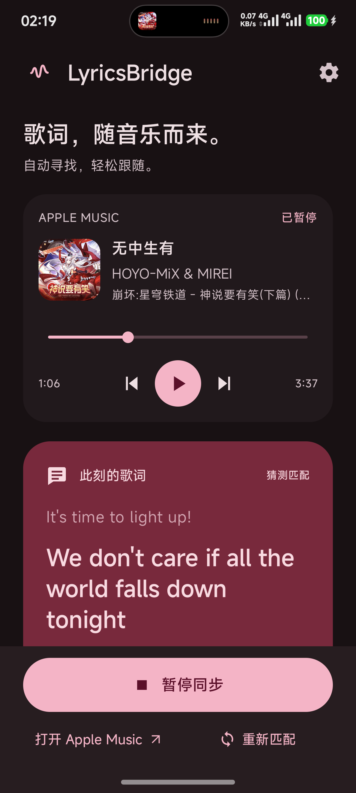
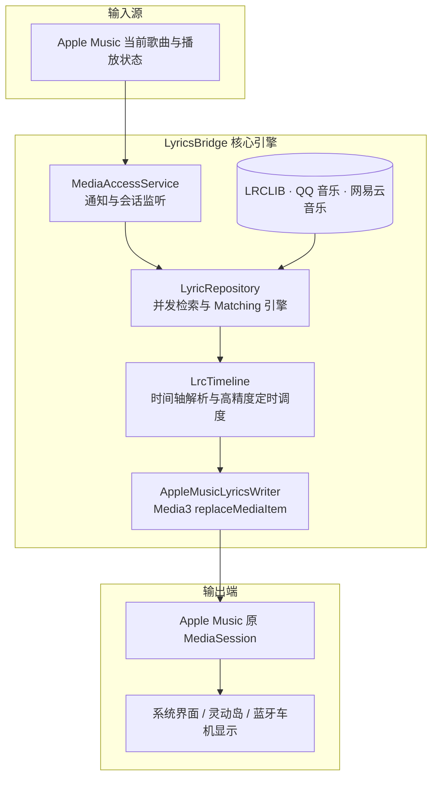

<p align="center">
  
</p>

<h1 align="center">LyricsBridge</h1>

<p align="center">
  <b>歌词，随音乐而来。</b><br>
  无需 Root、Shizuku 或 Hook · 为 Android 版 Apple Music 实时检索歌词并同步至 MediaSession 扩展字段
</p>

<p align="center">
  
  
  
  <a href="LICENSE"></a>
</p>

<p align="center">
  <b>简体中文</b> · <a href="README.en.md">English</a>
</p>

<p align="center">
  <a href="#界面预览">界面预览</a> •
  <a href="#功能特性">功能特性</a> •
  <a href="#快速开始">快速开始</a> •
  <a href="#歌词匹配">歌词匹配</a> •
  <a href="#工作原理">工作原理</a> •
  <a href="#兼容性与限制">兼容性与限制</a> •
  <a href="#源码构建">源码构建</a> •
  <a href="#测试">测试</a> •
  <a href="#免责声明">免责声明</a>
</p>

---

**LyricsBridge** 是一款专为 Android 平台设计的 Apple Music 歌词同步桥接工具。应用通过监听 Apple Music 当前播放状态与歌曲信息，并发从 **LRCLIB**、**QQ 音乐** 与 **网易云音乐** 检索精准的 LRC 歌词，并将动态时间轴实时写入 Apple Music 原生 `MediaSession` 的歌词扩展字段中，供支持该扩展规范的系统界面（如灵动岛/胶囊）或蓝牙车机读取显示。**全程无需 Root、Shizuku 或 Hook Apple Music。**

---

<a id="界面预览"></a>

## 📱 界面预览

<p align="center">
  
</p>

<p align="center"><sub>深色外观模式 · 手机实机运行截图</sub></p>

---

## 目录

- [界面预览](#界面预览)
- [功能特性](#功能特性)
- [快速开始](#快速开始)
- [歌词匹配](#歌词匹配)
- [工作原理](#工作原理)
- [兼容性与限制](#兼容性与限制)
- [源码构建](#源码构建)
- [测试](#测试)
- [技术栈](#技术栈)
- [免责声明](#免责声明)
- [许可证](#许可证)

---

<a id="功能特性"></a>

## ✨ 功能特性

| 功能模块 | 说明 |
| :--- | :--- |
| **多来源并发检索** | 并发查询 LRCLIB、QQ 音乐和网易云音乐，采用最先返回的可用精确歌词并自动取消其余开销。 |
| **目录元数据校正** | 未匹配到正常歌词时，自动提取 Apple 歌曲 ID 查询官方 iTunes 目录，使用校正后的歌名、歌手和专辑重新检索。 |
| **智能匹配提示** | 检索状态实时反馈；近似/模糊匹配结果会在应用界面及歌词开头显著标注，提示文本随语言自动切换。 |
| **高精度后台同步** | 实时跟随播放、暂停、拖动进度及自然切歌，基于 LRC 时间边界精准调度定时更新任务。 |
| **完整播放控制** | 提供播放/暂停、上一首/下一首、进度条拖动控制，以及带有平滑动画过渡的三行歌词预览卡片。 |
| **本地智能缓存** | 最多保存 100 条匹配结果；提供“重新匹配”功能，支持随时跳过当前歌曲的本地缓存重新抓取。 |
| **现代界面与多语言** | 基于 Material 3 设计，支持浅色/深色外观随系统自动切换；支持中文、英文及系统默认语言设置。 |

---

<a id="快速开始"></a>

## 🚀 快速开始

### 环境依赖

- **操作系统**：Android 8.0 (API level 26) 或更高版本。
- **目标应用**：设备上已安装 Android 版 Apple Music 并可正常播放音乐。
- **系统权限**：授权 **通知使用权（Notification Access）**，用于读取当前播放歌曲及访问媒体会话。
- **网络条件**：首次检索需连接互联网；已匹配的歌词会在本地自动复用缓存。

### 开启同步步骤

1. 参考 [源码构建](#源码构建) 编译生成 APK 并安装至设备。
2. 打开 LyricsBridge，在设置页面中授予 **通知使用权**，并允许状态通知。
3. 打开 Apple Music 选择任意歌曲开始播放。
4. 返回 LyricsBridge 查看当前歌曲的歌词及匹配来源。自动同步默认开启。
5. 若手动暂停了同步，可随时点击 **开启自动同步** 恢复；遇到误匹配时点击 **重新匹配** 即可重新检索。

> [!NOTE]
> **手动暂停记录**：手动暂停同步的状态会被持久化保存。自动同步开启时，打开应用、通知监听服务重新连接，或捕获到 Apple Music 的通知/活动会话变更，均可自动唤醒同步服务。

---

<a id="歌词匹配"></a>

## 🎯 歌词匹配

### 匹配流程


1. **读取缓存**：校验并复用当前歌曲的本机匹配记录。
2. **并发精确检索**：首先提交 LRCLIB 请求，同时并发查询 QQ 音乐与网易云音乐。采用最先返回的有效精确歌词，并自动取消其余正在进行的请求。
3. **目录信息校正**：未取得精确的正常歌词或仅找到纯音乐时，提取数字形式的 Apple 歌曲 ID 查询中国区（CN）与美国区（US）iTunes API 目录。若歌名或歌手存在差异，使用校正后的标准信息重新检索。
4. **模糊匹配回退**：若仍无精确结果，对符合条件的候选列表按歌名相似度排序；若存在纯音乐的精确结果，优先保留纯音乐结论。

### 匹配策略规则

| 匹配类型 | 触发条件与判定规则 |
| :--- | :--- |
| **精确匹配** | 标准化后的歌名完全一致，且至少有一位歌手一致；若双方时长已知，偏差不超过 1 秒。优先匹配同名专辑，其次按时长差排序。 |
| **模糊匹配** | 双方时长已知且偏差在 1 秒以内，同时至少有一位歌手一致；按歌名相似度综合排序，并结合时长差选优。 |
| **纯音乐** | 优先保留来源明确标记为纯音乐（Instrumental）的结果，并等待其他来源是否返回精确的文本歌词。网易云“无歌词”标识不会直接判定为纯音乐。 |

- **歌词来源数据**：[LRCLIB](https://lrclib.net/) · QQ 音乐 · 网易云音乐
- **目录校正数据**：[Apple iTunes Search / Lookup API](https://performance-partners.apple.com/search-api)

---

<a id="工作原理"></a>

## 🛠️ 工作原理



<details>
<summary><b>🔍 媒体会话实现与扩展字段说明（点击展开）</b></summary>

<br>

`MediaAccessService` 依靠通知使用权发现 Apple Music 激活的媒体会话；`BridgeService` 负责跟踪当前播放轨道与状态；`LrcTimeline` 实时解析 LRC 时间戳；`AppleMusicLyricsWriter` 借助 Media3 的 `replaceMediaItem` 接口安全更新原会话的 `MediaMetadata` 歌词扩展字段。

| 扩展字段 Key | 字段类型 | 内容说明 |
| :--- | :--- | :--- |
| `ucar.media.metadata.LYRICS_WHOLE` | `String` | 整首带时间戳的完整 LRC 歌词文本，或未匹配状态提示文本 |
| `ucar.media.metadata.LYRICS_LINE` | `String` | 当前时间点所对应的单行歌词文本 |
| `ucar.media.metadata.LYRICS_STATUS` | `Long` | 歌词可用状态标志：`0` 表示歌词正常可用；`1` 表示暂无歌词或纯音乐 |

同步过程完整保留原始歌曲的标题、歌手及队列标识符。后台同步利用媒体回调与歌词时间边界进行休眠调度，并通过低干扰的前台服务（Foreground Service）通知维持系统存活。

</details>

---

<a id="兼容性与限制"></a>

## ⚠️ 兼容性与限制

- **显示端兼容性**：系统界面或蓝牙车机须支持并主动读取 `ucar.media.metadata.*` 歌词扩展字段。小米超级岛、CarWith 等界面的实际显示效果取决于具体设备、系统版本及接收端应用的实现逻辑。
- **Apple Music 版本依赖**：歌词写入依赖当前客户端的 Media3 行为特征，App 版本升级可能引发兼容性变化。已在小米 15（HyperOS 4）上验证通过返回桌面后的自然连播与逐句歌词更新。
- **第三方接口稳定性**：QQ 音乐与网易云音乐使用非公开 API，未来可能存在变动或临时不可用的风险。网络数据源中的错误时长、版本及歌手信息可能影响最终匹配精度。
- **多语言与原版歌词**：iTunes Lookup 仅能校正能够查询到的目录信息。目前暂不支持跨地区歌曲 ID 自动关联、建立完整多语言歌名映射或直接读取 Apple Music 原版歌词。
- **系统后台限制与恢复**：系统的省电策略与自启动限制可能导致后台同步中断。`START_STICKY` 允许系统尝试重建服务，但无法保证无延迟恢复。项目未集成开机广播接收器；若应用被强行停止，需手动打开应用唤醒。

> [!TIP]
> **问题反馈提示**：提交 Issue 时，请附上设备型号、系统版本、Apple Music 版本、歌曲与专辑名称、选用的歌词来源，并说明异常现象发生在前台还是后台。

---

<a id="源码构建"></a>

## 🏗️ 源码构建

请确保本地已安装 **Android SDK Platform 37**，并推荐使用项目自带的 Gradle Wrapper 进行构建。Gradle Daemon 的 JDK 25 工具链配置可参阅 [`gradle/gradle-daemon-jvm.properties`](gradle/gradle-daemon-jvm.properties)。

```bash
# 克隆仓库
git clone https://github.com/Ryan1202/LyricsBridge.git
cd LyricsBridge

# 构建 Debug 版本 APK
./gradlew :app:assembleDebug
```

编译生成的 APK 产物路径：

```text
app/build/outputs/apk/debug/app-debug.apk
```

---

<a id="测试"></a>

## 🧪 测试

运行单元测试与 Lint 静态分析检查：

```bash
./gradlew :app:testDebugUnitTest :app:lintDebug
```

- **单元测试目录** [`app/src/test`](app/src/test)：涵盖 LRC 歌词解析、歌曲匹配算法及发布提示生成等单元测试。
- **集成测试目录** [`app/src/androidTest`](app/src/androidTest)：涵盖真实歌词 API 接入、并发源选择、缓存校正逻辑及 Apple Music 会话交互测试。

> [!IMPORTANT]
> **集成测试注意事项**：运行 androidTest 需在已登录 Apple Music 且已授予通知使用权的实体设备或模拟器上执行。测试过程中会自动切换歌曲、拖动进度及控制播放。

---

<a id="技术栈"></a>

## 🛠️ 技术栈

| 领域 / 组件 | 技术选型与版本 |
| :--- | :--- |
| **编程语言** | Kotlin `2.2.10` |
| **UI 架构** | Jetpack Compose、Material 3、StateFlow |
| **媒体与会话** | Android Media3 Session `1.8.0`、`MediaSessionManager`、`NotificationListenerService` |
| **并发与调度** | `Executors`、`ExecutorCompletionService`、`Handler` / `Looper` 时间边界调度 |
| **SDK 目标版本** | minSdk `26` (Android 8.0)、compileSdk `37`、targetSdk `37` |
| **构建系统** | Android Gradle Plugin `9.5.1`、Gradle Wrapper `9.6.0`、JDK 25 Daemon |

---

<a id="免责声明"></a>

## ⚖️ 免责声明

- 本项目为个人开源项目，与 Apple Inc.、腾讯（QQ 音乐）、网易（网易云音乐）及 LRCLIB 无官方关联，文中商标归各自版权方所有。
- 项目调用的部分歌词接口为非官方公开接口，可能因原服务商调整而随时变更或失效。
- 本项目的使用、修改与分发遵循 GPL-3.0-only 许可证。如需反馈内容权属问题，请提交 Issue。

---

<a id="许可证"></a>

## 📄 许可证

Copyright (C) 2026 Ryan1202

本项目采用 **GNU General Public License v3.0**（GPL-3.0-only）开源协议，完整条款请参阅 [LICENSE](LICENSE)。
